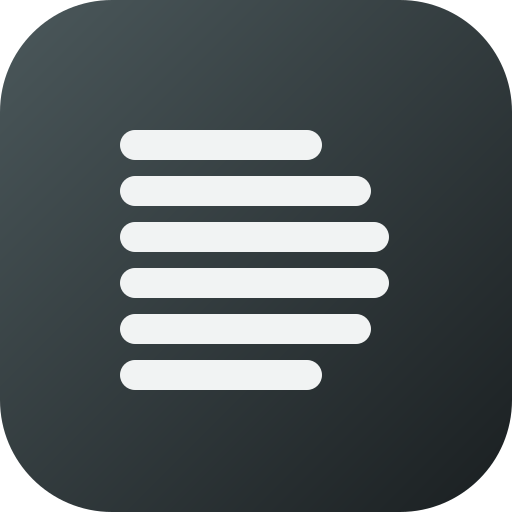
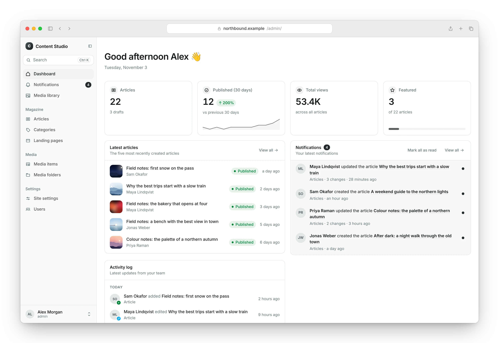

<p align="center">
  
</p>

<h1 align="center">Django Content Studio</h1>

<p align="center">
  <a href="https://badge.fury.io/py/django-content-studio"></a>
  <a href="https://pypi.org/project/django-content-studio/"></a>
  <a href="https://pypi.org/project/django-content-studio/"></a>
  <a href="https://github.com/dwarsbit/django-content-studio/actions/workflows/ci.yml"></a>
  <a href="LICENSE"></a>
</p>

Django Content Studio is a modern alternative to the classic Django admin.
Register the models you already have and manage them in an admin with list
pages, edit pages, a dashboard and a media library. Optional fields and
models help with content-driven projects.

<p align="center"><strong>Documentation: <a href="https://djangocontentstudio.org/">djangocontentstudio.org</a></strong></p>

<picture>
  <source media="(prefers-color-scheme: dark)" srcset="https://raw.githubusercontent.com/dwarsbit/django-content-studio/main/website/static/img/screenshots/dashboard-dark.webp">
  
</picture>

## Features

- **Your models, as they are**: register a plain Django model, as in the
  classic Django admin. There is nothing to migrate to.
- **List pages** with search, filters, sorting, bulk actions, a trash and
  export.
- **Edit pages laid out in Python**, with widgets for dates, rich text,
  tags, colors, media and structured JSON, block fields, and text
  components.
- **A dashboard** with statistics, content lists, recent activity and
  background tasks.
- **A media library** with folders, uploads, crops, focal points and image
  sizes.
- **Collaboration**: notifications, presence avatars and a command palette.
- **Access control** that follows the permission hooks of the classic
  Django admin, down to single objects.
- **Multi-tenancy**: one method decides which tenants an editor may work in.
- **Extensions, webhooks and built-in fields and models** such as
  `HTMLField`, `ColorField` and `ContentModel`, all optional.

Content Studio does not render your website. It manages content, the way
the classic Django admin does.

## Requirements

- Python 3.12 or later
- Django 5.2, 6.0 or 6.1

## Quick start

1. Install the package:

   ```bash
   pip install django-content-studio
   ```

2. Add the apps to your settings:

   ```python
   # mysite/settings.py
   INSTALLED_APPS = [
       "django.contrib.admin",
       "django.contrib.auth",
       "django.contrib.contenttypes",
       "django.contrib.sessions",
       "django.contrib.messages",
       "django.contrib.staticfiles",
       "rest_framework",
       "content_studio",
       "blog",
   ]
   ```

3. Mount the admin:

   ```python
   # mysite/urls.py
   from django.urls import include, path

   urlpatterns = [
       path("admin/", include("content_studio.urls")),
   ]
   ```

4. Register one of your models in your app's `admin.py`. The example uses
   an `Article` model with a `title` and a `status` field:

   ```python
   # blog/admin.py
   from content_studio import register
   from content_studio.admin import ModelStudio

   from .models import Article


   @register(Article)
   class ArticleStudio(ModelStudio):
       table_display = ["title", "status"]
       list_filter = ["status"]
       search_fields = ["title"]
   ```

5. Start the development server, open `/admin/` and log in with a staff
   account.

Continue with [Getting started](https://djangocontentstudio.org/docs/getting-started)
in the documentation.

## Documentation

The full documentation is at [djangocontentstudio.org](https://djangocontentstudio.org/).
Good places to start:

- [Introduction](https://djangocontentstudio.org/docs/intro): what Content Studio is, and what it is not
- [Getting started](https://djangocontentstudio.org/docs/getting-started): installation and your first model
- [Registering models](https://djangocontentstudio.org/docs/registering-models): studio options, singletons and inlines
- [Edit page layout](https://djangocontentstudio.org/docs/edit-page): form sets, the sidebar and components
- [Access control](https://djangocontentstudio.org/docs/permissions): model and object permissions
- [Deployment](https://djangocontentstudio.org/docs/deployment): a deployment checklist and system checks
- [How it compares](https://djangocontentstudio.org/docs/comparison): Content Studio next to admin themes and content management systems
- [AI agents](https://djangocontentstudio.org/docs/ai-agents): `llms.txt` and an agent skill for AI coding agents

See also [Django Headless](https://djangoheadless.org), if you need an API
for your own clients.

## Contributing and support

- Read [CONTRIBUTING.md](CONTRIBUTING.md) to set up the project and propose a change.
- Report bugs in [GitHub Issues](https://github.com/dwarsbit/django-content-studio/issues) and ask questions in [GitHub Discussions](https://github.com/dwarsbit/django-content-studio/discussions).
- Report security problems privately; see [SECURITY.md](SECURITY.md).

## License

MIT; see [LICENSE](LICENSE). Changes are listed in the [changelog](CHANGELOG.md).
